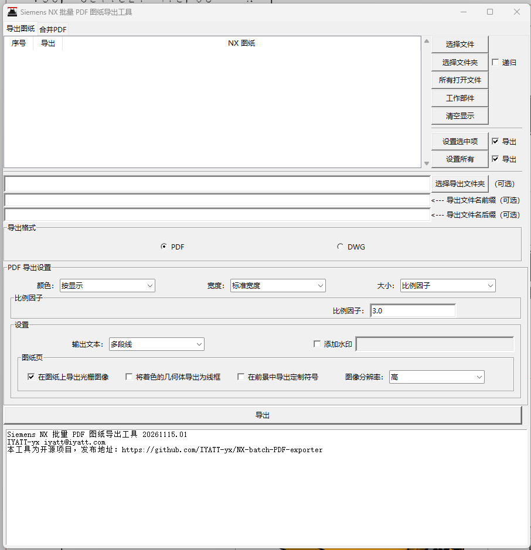
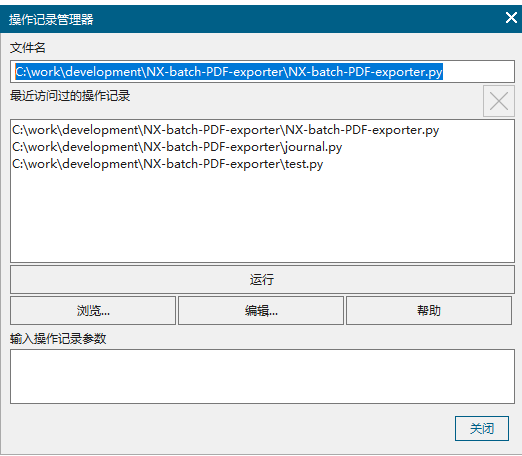
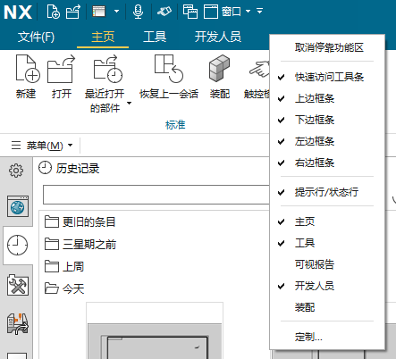
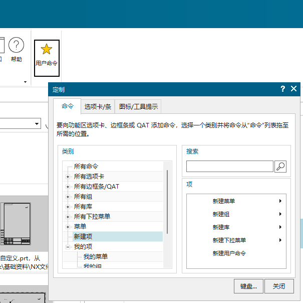
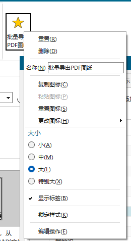
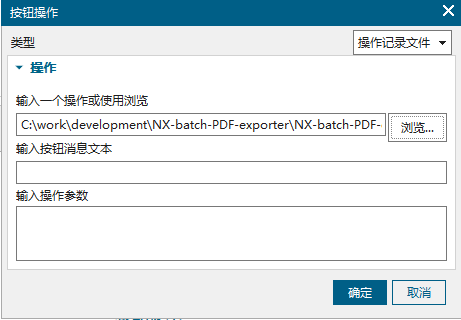
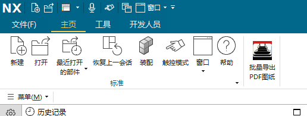

# NX-batch-PDF-exporter【Siemens NX/Designcenter 批量 PDF 图纸导出工具】

  
NX-batch-PDF-exporter 是为 Siemens NX/Designcenter 开发的批量图纸导出工具。

## 功能说明

* 选择要导出的目标图纸：①选择文件：可以多选图纸文件；②选择文件夹：指定文件夹后会过滤出 .prt 图纸文件，如果勾选了递归，则还会额外去子目录中过滤图纸文件；③显示文件：获取当前 NX 中已经打开的 .prt 文件；④清空显示：删除视图中显示的图纸列表。不清空的情况下，新添加图纸会不断累加在视图中，以实现同时多选不同文件夹中的图纸一起导出。同时还会做去重处理，重复选择到同一个文件，视图中只会显示一个。  
* 批量设置状态：左侧视图中可以通过按住`Shift`连选或`Ctrl`多选，点击“设置选中项”，就可以设置选中图纸的导出状态。勾选了导出则设为导出状态，没勾选就设置为不导出。“设置所有”则是把所有显示的图纸导出状态设置为右侧勾选的状态。  
* 导出相关：①导出文件夹：留空则导出到每个 .prt 所在的文件夹，指定时则导出到指定的文件夹。②前缀和后缀：前缀会添加到 PDF 文件名的开头，后缀会添加到 PDF 文件名的结尾。④点击“导出”会开始执行。

## 测试环境

* Siemens NX 2506（停止测试）
* Designcenter 2606（正在测试）

## 使用方法

### 方式一

按`Alt`+`F8`打开“操作记录管理器”，浏览本工具中“NX-batch-PDF-exporter.py”所在路径，点击运行即可  


### 方式二

在菜单栏空白处右键，点击“定制”  
  

在命令选项卡下，左侧点新建项，右边点击新建用户命令拖动到菜单栏上  
  

在新建的图标上右键，可以设置名称，再点击最下面编辑操作  
  

浏览 “NX-batch-PDF-exporter.py” 所在路径即可  
  

现在可以通过直接点击图标运行了  


## 国际化

【1】词条提取:  
```bash
python .\locales\i18n\pygettext.py -d messages -o .\locales\messages.pot .
```

【2】翻译词条：  
生成的词条位于 `.\locales\messages.pot` 文件中。  
如果计划翻译美式英语，则创建文件夹 `.\locales\en_US\LC_MESSAGES`  
```bash
mkdir .\locales\en_US\LC_MESSAGES
```
将 `.\locales\messages.pot` 复制并改名到 `.\locales\en_US\LC_MESSAGES\messages.po`  
```bash
copy .\locales\messages.pot .\locales\en_US\LC_MESSAGES\messages.po
```

可以对`.\locales\en_US\LC_MESSAGES\messages.po`进行翻译，`msgid`是词条，`msgstr`是翻译后的内容。  

【3】编译词条：  
```
python .\locales\i18n\msgfmt.py -o locales\en_US\LC_MESSAGES\messages.mo locales\en_US\LC_MESSAGES\messages.po
```

【4】说明：  
本工具会自动获取系统的语言，并匹配对应语言文件夹下的 mo 文件用于工具实际的语言显示，没有匹配语言的 mo 文件时则显示中文。语言文件夹命名如：美式英语 en_US，日语 ja_JP，德语 de_DE 等。    

## 版权与许可

本项目采用 [MIT License](LICENSE) 开源。  

### 第三方组件声明

* pypdf：开源协议 [BSD 3-Clause License](lib/pypdf-6.7.5/LICENSE)。用于实现 PDF 合并。